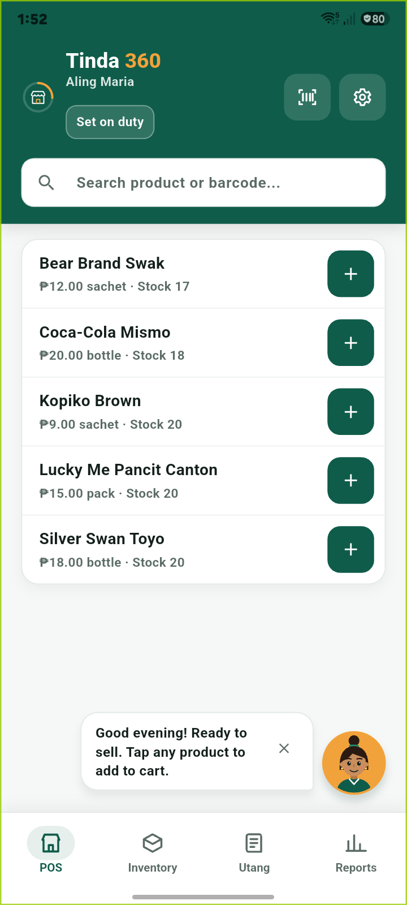
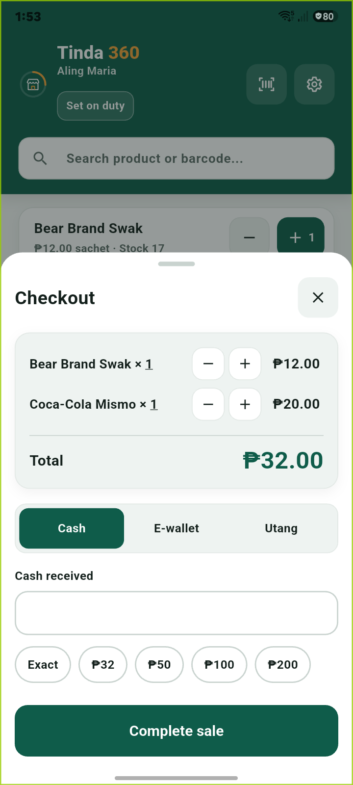
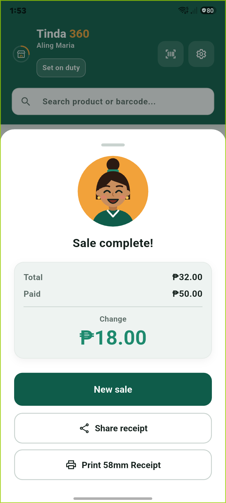

<p align="center">
  
</p>

<h1 align="center">Tinda 360</h1>

<p align="center">
  <strong>Free smart POS from a community NGO, even completely offline</strong><br>
  Built by <a href="https://bukluran.com">Bukluran ng Kalinga ng Mamamayang Distrito Singko Inc.</a>
</p>

<p align="center">
  <a href="https://github.com/GodYtteria/Tinda360/releases/latest"></a>
  <a href="LICENSE"></a>
  <a href="https://github.com/GodYtteria/Tinda360/actions"></a>
  <a href="https://flutter.dev"></a>
  <a href="https://tinda360.bukluran.com"></a>
</p>

<p align="center">
  <a href="https://github.com/GodYtteria/Tinda360/releases/latest/download/app-arm64-v8a-release.apk">
    
  </a>
</p>

---

## Why Tinda 360?

**A community project by Bukluran.** Tinda 360 is a project of Bukluran ng Kalinga ng Mamamayang Distrito Singko Inc., a registered non-profit serving communities across the Philippines. It was built for sari-sari store owners who lack access to expensive POS systems.

**The problem.** The owner of a sari-sari store is often away, so a relative or neighbor tends it. Counting stock is hard, utang is written in a notebook, and the owner cannot tell if the earnings are right or the cash drawer is short.

**The solution.** A simple phone app that works without internet. The helper just taps to sell, items with no stock cannot be sold, and each suki's utang is recorded automatically. The owner has a PIN for sensitive actions and an end-of-day cash count.

**The impact.** Free and open source, no monthly fee, and no expensive equipment needed. Utang is clearer, less money goes missing, and owners trust their helpers more. **1,000+ store owners** are already using the early version.

> Sell, track inventory and utang, and ask the on-device AI assistant — all on your phone, completely free.

---

## Screenshots

<p align="center">
  
  &nbsp;&nbsp;
  
  &nbsp;&nbsp;
  
  &nbsp;&nbsp;
  
</p>

---

## Features

Everything your store needs. Simple to learn, fast at the counter — with clear English and Filipino UI, Dark Mode, and Large Text accessibility support.

| Feature | Description |
|---------|-------------|
| **POS** | Sell with cash, e-wallet, or utang. Quick peso buttons, instant change, split payment, optional interest. |
| **Inventory** | Live stock ledger, low-stock alerts, barcode scanner, expiry tracking, restock shopping list. |
| **Utang Ledger** | Per-suki balances, credit limits, partial payments, history, and reminders. |
| **Smart Store Assistant** | On-device AI — ask about sales, profit, trends, busiest hours, loyal customers, stock forecast, and more. |
| **Reports** | Today, week, month, or custom range. Revenue, profit, expenses, returns, trend charts, and Top 3 products. |
| **Multi-Store** | Switch between stores, each with its own database and Google Drive backup. |
| **Bantay Mode** | PIN-protected sensitive actions. Every sale records who was on duty. |
| **Cash Count** | End-of-day cash count to reconcile the drawer. |
| **Receipts** | Share as text or print on a 58mm thermal printer. |
| **Backup** | Google Drive (private app folder) or local file export. |
| **Offline-First** | Everything runs on-device. No internet needed except for optional backup. |
| **Bilingual** | Filipino and English UI. Dark mode and large text accessible. |

---

## Tech Stack

| Layer | Technology |
|-------|-----------|
| Framework | [Flutter](https://flutter.dev) (Dart) |
| Database | [Drift](https://drift.simonbinder.eu/) (SQLite) |
| State | [Riverpod](https://riverpod.dev/) |
| AI | On-device intent matching (no cloud API) |
| Backup | Google Drive `appdata` scope |
| CI/CD | GitHub Releases |

---

## Getting Started

### Prerequisites

- [Flutter SDK](https://docs.flutter.dev/get-started/install) (stable channel)
- Android SDK (API 21+)
- A physical device or emulator

### Build from source

```bash
# Clone the repo
git clone https://github.com/GodYtteria/Tinda360.git
cd Tinda360

# Install dependencies
flutter pub get

# Generate database code
dart run build_runner build --delete-conflicting-outputs

# Generate localizations
flutter gen-l10n

# Run tests
flutter test

# Build release APK
flutter build apk --release --split-per-abi
```

### Configuration

| File | Purpose |
|------|---------|
| `config/dart_defines.json` | Google OAuth web client ID (create your own for backup) |
| `android/key.properties` | Signing keystore details (never committed) |

> **Note:** The app works fully offline without Google credentials. The OAuth client ID is only needed if you want to enable Google Drive backup.

---

## Project Structure

```
lib/
├── core/           # Domain models (money, products, sales, customers)
├── data/
│   ├── db/         # Drift database, tables, migrations
│   └── repositories/  # Data access layer
├── features/
│   ├── pos/        # Point of sale, checkout, cart, receipts
│   ├── inventory/  # Product management, CSV import/export
│   ├── utang/      # Customer debt tracking, payments
│   ├── ulat/       # Reports, cash count, expenses
│   ├── chat/       # Smart Store Assistant (on-device AI)
│   ├── settings/   # Store profile, backup, multi-store
│   ├── onboarding/ # First-run setup, splash screen
│   └── home/       # Home screen, error states
├── services/       # Backup, biometrics, printing, crash logs
├── shared/         # Reusable widgets, formatters
├── theme/          # Design tokens, colors, typography
└── l10n/           # Filipino and English translations

test/               # 100+ unit and widget tests

The marketing site source at tinda360.bukluran.com lives in a separate private
repository (GodYtteria/tinda360-website); only its screenshots are kept here.
```

---

## Privacy & Data Safety

**Your data, your control. No subscriptions, no ads, no tracking servers.**

- **Zero ads, zero trackers** — no analytics or third-party telemetry. Your sales and utang records never leave your phone unless you choose to back up.
- **All data stays on-device** — stored locally in SQLite, including the on-device AI assistant. No store queries or financial figures are sent to external AI servers.
- **Private Google Drive app folder** — backup uses only the `drive.appdata` scope; Tinda 360 cannot read, modify, or delete your other Drive files.
- **Centavo-exact math** — integer minor-unit accounting and half-up rounding per line, with no floating-point errors on change or profit.

Read the full [Privacy Policy](https://tinda360.bukluran.com/privacy) and [Terms of Service](https://tinda360.bukluran.com/terms).

---

## Support the Mission

**Help us reach more stores that need it.** Tinda 360 is free with no ads — built for underserved communities and sustained by donations, volunteers, and partnerships. Here is how you can help:

- **Donate** — Even a small contribution creates real social impact — it helps fund testing devices, server costs, and deploying the app to marginalized communities without access to technology → [Get in touch](mailto:officialtinda360@bukluran.com?subject=Donation%20Inquiry)
- **Volunteer** — Developer, designer, or grassroots organizer? Help us improve the app, translate to more languages, or deploy to underserved barangays across the Philippines → [Join the team](mailto:officialtinda360@bukluran.com?subject=Volunteer%20Inquiry)
- **Partner with us** — LGU, NGO, CSR program, or social enterprise looking to support grassroots economic empowerment → [Become a partner](mailto:officialtinda360@bukluran.com?subject=Partnership%20Inquiry)

---

## License

```
Copyright 2026 Bukluran ng Kalinga ng Mamamayang Distrito Singko Inc.

Licensed under the Apache License, Version 2.0.
See LICENSE and NOTICE for details.
```

The **Bukluran** and **Tinda 360** names and logos are not covered by the Apache License and may not be used to suggest endorsement of a modified version without written permission.

---

<p align="center">
  <sub>Made with ❤️ in the Philippines by <a href="https://bukluran.com">Bukluran</a></sub>
</p>
